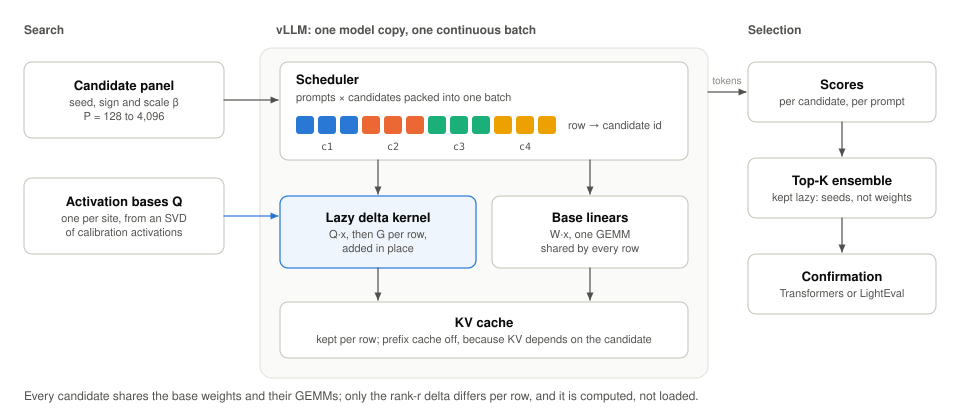

<p align="center">
  <picture>
    <source media="(prefers-color-scheme: dark)" srcset="docs/assets/logo-dark.svg">
    
  </picture>
</p>

<p align="center">
  Zeroth-order post-training for language models.<br>
</p>

<p align="center">
  <a href="docs/how-it-works.md">How it works</a> ·
  <a href="docs/results.md">Results</a> ·
  <a href="docs/quickstart.md">Quickstart</a> ·
  <a href="docs/related-work.md">Related work</a>
</p>

---

Optimus samples small random perturbations of a pretrained model, scores each
one on a task, and keeps the best. Each candidate is a rank-$r$ delta,
$β \cdot G_c \cdot Q \cdot x$, computed inside the forward pass. $Q$ is an activation basis
shared by every candidate; $G_c$ is a random field rebuilt from the candidate's
seed inside a Triton kernel. Nothing per candidate is stored or loaded, so one
vLLM model copy serves the whole population.



## Install

```bash
python -m pip install -e ".[serving]"
```

## Run

```bash
optimus make-countdown-data --out data/countdown.json --count 1200 --seed 20260507

optimus search --backend vllm --method subspace --kernel custom-op \
  --out results/subspace_p128 --data data/countdown.json \
  --population 128 --prompts 8 --basis-rank 64 --target-preset qv
```

The [quickstart](docs/quickstart.md) covers the reference backends, kernel
settings, parity gates and reports.

## Status

- Reference search through Transformers and the multi-LoRA vLLM baseline are
  supported.
- Subspace search through vLLM runs from a forward hook with Triton kernels:
  13.9 candidates/s at population 128 on one L40S, about 2.3 times the bridge
  built on vLLM's LoRA kernels ([results](docs/results.md)).
- Not done yet: a fused custom op, and strict logprob parity with native
  adapter replay.

## Documentation

`docs/` is a MkDocs site (`mkdocs serve`) with a Read the Docs configuration in
`.readthedocs.yaml`. Figures are generated by `node tools/figures/build.mjs`.

## Citation

Optimus implements search in the style of RandOpt: Gan and Isola,
[*Neural Thickets: Diverse Task Experts Are Dense Around Pretrained Weights*](https://arxiv.org/abs/2603.12228),
2026.
