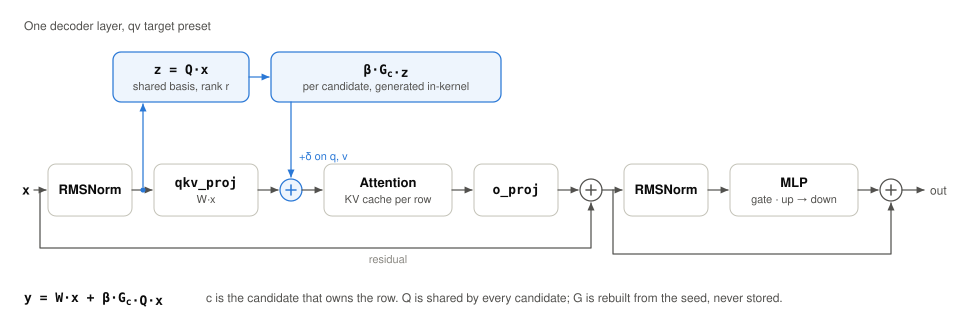

# How it works

RandOpt-style post-training samples many small random perturbations of a
pretrained model, scores each one on a task, and keeps the best one or a top-K
ensemble. There are no gradients. Almost all of the cost is evaluating
candidates, so the question Optimus answers is how to evaluate thousands of
perturbed models without loading thousands of models.

The answer has two halves. Inside a transformer block, each candidate is a
low-rank delta computed on the fly. Inside the serving stack, rows that belong
to different candidates share one batch, one copy of the weights, and the same
base GEMMs.

## Inside one decoder layer



For a target linear module `t` that reads activation site `s`, candidate `c`
changes the output of that module to

```text
y = W x + β_t · G_t,c · Q_s · x
```

| symbol | what it is | shared across candidates? |
| --- | --- | --- |
| `W` | the pretrained weight of the target module | yes |
| `Q_s` | orthonormal basis, rank `r`, from an SVD of activations captured at site `s` on calibration prompts | yes |
| `G_t,c` | standard Gaussian field, regenerated from the candidate seed, the target and the element index | no |
| `β_t` | scale for target `t`, resolved so that the perturbation has a chosen output RMS | yes |

Algebraically this is a rank-`r` weight update, `ΔW = β G Q`. It is never
materialized. The forward pass computes `z = Q x` once per activation site,
then `β G_c z` per row, and adds the result into the module output.

Sites follow the block structure. In the default `qv` preset the attention input
feeds one shared basis, and only the `q` and `v` slices of the fused `qkv_proj`
output receive a delta. Other presets add `o_proj` (`attn-qkvo`), the MLP
linears (`mlp`), or every linear in the block (`transformer-linears`).

## Inside the serving stack


1. **Candidate panel.** A candidate is an identity, not a tensor: seed, sign,
   scale and target set. Runs record every candidate they score, so any of
   them can be rebuilt later from its record.
2. **Packing.** Prompts for many candidates go into one vLLM batch. Optimus
   keeps a row-to-candidate table so every activation row knows which
   candidate owns it.
3. **Base linears.** The pretrained GEMMs run once for the whole batch. This is
   most of the FLOPs, and it is shared by every candidate.
4. **Delta kernel.** For each hooked module: one `Q x` projection per site,
   then a Triton kernel that generates `G_c` in registers from a counter-based
   hash, multiplies by `z` and adds into the fused `qkv` output in place. No
   per-candidate factors are stored or loaded. This is the
   `triton-counter-inplace` backend; the default `torch` backend computes the
   same delta as a reference.
5. **KV cache.** Keys and values depend on the candidate, so the KV cache is
   per row and prefix caching stays off. The CLI rejects runs that enable it.
6. **Selection.** Each candidate gets a score per prompt. The top K are kept as
   seeds (a lazy ensemble) and confirmed on a trusted backend (Transformers or
   LightEval) before any claim is made.

## Relation to multi-LoRA serving

The delta has the same shape as a LoRA adapter, and the kernel structure is
the one Punica's SGMV and S-LoRA use: a *shrink* GEMM into rank `r`, then an
*expand* GEMM back to the output dimension, with a per-row adapter index.
Optimus differs in two places:

- **The shrink is shared.** `Q_s` depends on the site, not the candidate, so
  `Q x` is one dense GEMM for the whole batch instead of a gathered per-row
  product.
- **The expand weights are generated, not loaded.** `G_c` comes from a hash of
  the candidate seed. There is no adapter memory, no adapter loading, and no
  limit on population size from adapter slots.

The first version of the hook reused vLLM's Triton `lora_shrink` and
`lora_expand` kernels with cached factor stacks. That bridge is the baseline in
the [results](results.md). See [related work](related-work.md) for references.

## What is not done yet

- **A fused custom op.** `Q x`, the counter expand and the in-place add are
  still separate launches driven from a Python hook. The next step is a vLLM
  custom op that computes one `Q x` per row block and schedules the expand
  under vLLM's routing. `KERNEL.md` tracks the attempts that did not work.
- **Strict parity.** At zero scale, hook replay matches native adapter replay
  exactly. At nonzero scale the first generated token matches, but top-logprob
  tails drift in late layers (hook versus adapter injection, plus bf16
  accumulation order). Score-level replay
  across candidate batch sizes still differs on 1 of 128 candidates.
