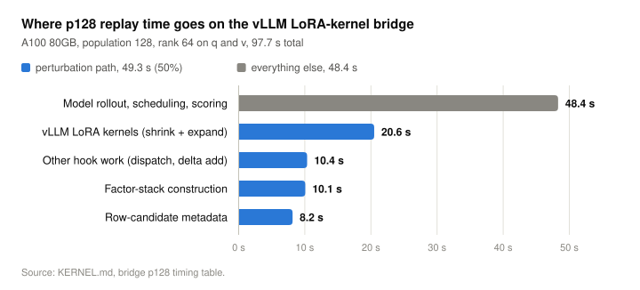
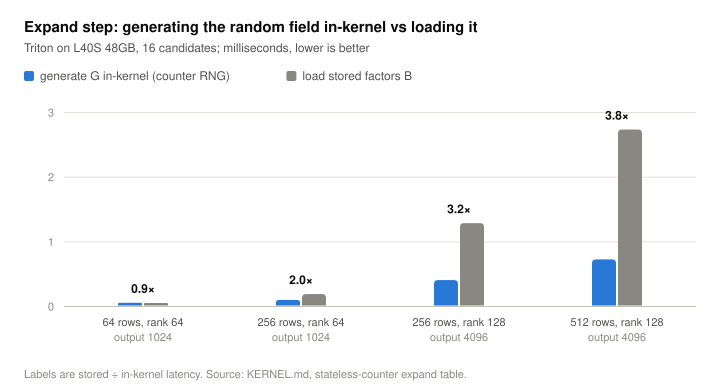
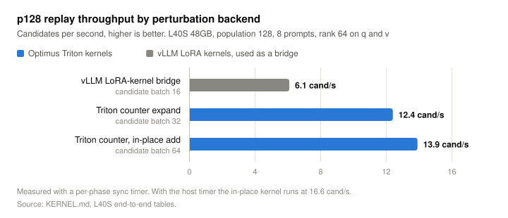

# Results

These are systems measurements for the subspace search path: how fast
candidates can be evaluated, and where the time goes. They are not quality
claims; those need the trusted confirmation described in
[evaluation](evaluation.md).

Every number comes from the measurement tables in
[`KERNEL.md`](https://github.com/plugyawn/optimus/blob/main/KERNEL.md) and the
per-change logs in
[`experiments/`](https://github.com/plugyawn/optimus/tree/main/experiments).
The raw run artifacts live under the ignored `results/` tree. The plotted values
are in `tools/figures/data.mjs`, and `node tools/figures/build.mjs` redraws
every figure.

## Where the time goes

The first working path reused vLLM's LoRA kernels from a forward hook. Half of
replay time was in the perturbation path, and less than half of that was the
kernels themselves. Building per-candidate factor stacks and routing metadata
cost almost as much as the GEMMs.

| part | seconds |
| --- | ---: |
| Model rollout, scheduling, scoring | 48.4 |
| vLLM LoRA kernels (shrink + expand) | 20.6 |
| Other hook work (dispatch, delta add) | 10.4 |
| Factor-stack construction | 10.1 |
| Row-candidate metadata | 8.2 |
| **Total** | **97.7** |

A100 80GB, population 128, rank 64 on `q` and `v`.

## Generating the random field in the kernel

Instead of building `B = β G_c` for each candidate and loading it, the counter
kernel recomputes `G_c` from the seed inside the expand step. At the smallest
shape this is slightly slower. From 256 rows up it is 2 to 3.8 times faster,
because the expand step stops reading candidate factors from memory.

| rows | rank | output dim | stored factors (ms) | in-kernel field (ms) |
| ---: | ---: | ---: | ---: | ---: |
| 64 | 64 | 1024 | 0.047 | 0.050 |
| 256 | 64 | 1024 | 0.185 | 0.094 |
| 256 | 128 | 4096 | 1.281 | 0.401 |
| 512 | 128 | 4096 | 2.729 | 0.721 |

Triton on an L40S 48GB, 16 candidates.

## End-to-end throughput

| backend | candidate batch | candidates/s |
| --- | ---: | ---: |
| vLLM LoRA-kernel bridge | 16 | 6.1 |
| Triton counter expand | 32 | 12.4 |
| Triton counter, in-place add | 64 | 13.9 |

L40S 48GB, population 128, 8 prompts, rank 64 on `q` and `v`. The
bridge cannot run a candidate batch of 32 on this card: it runs out of memory
holding factor stacks. The counter kernels hold none, which is what allows the
larger batches. At population 1,024 the in-place kernel holds 13.8
candidates/s.

Two lessons from getting here, both recorded in `KERNEL.md`:

- **Specialization keys matter.** With the row count declared as a Triton
  `constexpr`, a warm p16 run reached 8.4 candidates/s but p128 collapsed to
  0.37, because vLLM decode produces many distinct row counts and each one
  compiled a new kernel. Passing it as a runtime value fixed it.
- **The timer was part of the bottleneck.** The numbers above use a
  per-phase sync timer. The same in-place configuration measures 16.6
  candidates/s with the host timer, which is now the default.

## What these numbers do not show

- **Quality.** Throughput says nothing about whether the selected candidates
  transfer to held-out prompts.
- **Strict parity.** Hook replay matches native adapter replay exactly at zero
  scale. At nonzero scale the first token matches but late-layer logprobs
  drift. Changing the candidate batch size changes the score of 1 candidate
  in 128.
- **A fused op.** These are separate launches driven from a Python hook.
  Kernel-only work has little room left: in the p1024 counter run the kernel
  was 3.7 s of 99 s scoring, while the whole perturbation path, including hook
  dispatch and the separate `Q x`, was 33 s.
